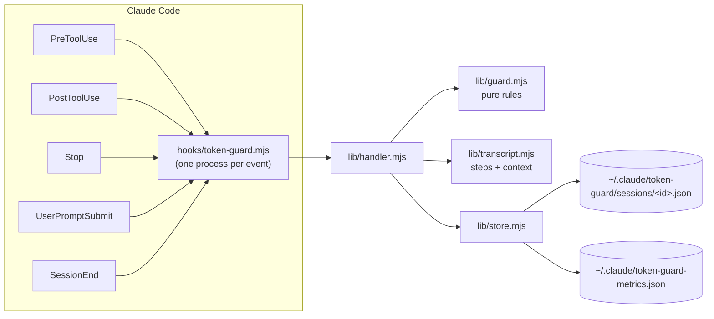

# Doc: `token-guard` plugin

`token-guard` keeps long Claude Code sessions from burning tokens. Cost grows with
steps × context, so the plugin refuses step-wasting Bash patterns and tells the model
when it verifies too often, when the session or context grows past a budget, and when
it pushes project work onto the user.

User-facing reference (guards, defaults, variables, install): the plugin
[`README.md`](../../plugins/token-guard/README.md). Intent and acceptance criteria:
[`specs/token-guard/`](../../specs/token-guard/0001_product_token-guard.md).

## How it is wired

- **One entry point for all events.** `hooks.json` registers the same command for
  five events; `handler.mjs` dispatches on `hook_event_name`.
- **State in a file, not in memory.** Claude Code starts a fresh process per hook
  event, unlike opencode's long-lived plugin. Counters live in one JSON file per
  session, read and written under a lock directory and replaced atomically, because
  parallel tool calls run hooks concurrently.
- **Steps and context from the transcript.** The hook input carries
  `transcript_path`. `transcript.mjs` reads only the new bytes since the last event,
  counts one step per distinct assistant `message.id` (one response can span several
  lines) and takes the context size from the last response's `usage`. Subagent lines
  (`isSidechain`) are skipped.
- **How notes reach the model.** `PreToolUse` refuses with
  `permissionDecision: deny` plus a reason. `PostToolUse` and `UserPromptSubmit`
  return `additionalContext`. `Stop` cannot add context to a finished turn, so it
  shows the note as `systemMessage` and queues it for the next `UserPromptSubmit`.
- **Fail-open.** Any internal error exits 0 without output. `hooks.json` checks for
  node first. An invalid `session_id` (anything outside `[A-Za-z0-9_-]`) is never
  used as a file name.

## Relationship to the opencode plugin

The rules in `lib/guard.mjs` are a hand port of `plugins/opencode/opencode-token-guard/src/guard.ts`.
`tests/token-guard/parity.test.mjs` runs both on shared fixtures so the copy cannot
drift unnoticed; every deliberate difference is a fixture marked `deviation` and
asserted to still differ. The differences and why: spec §6a.
